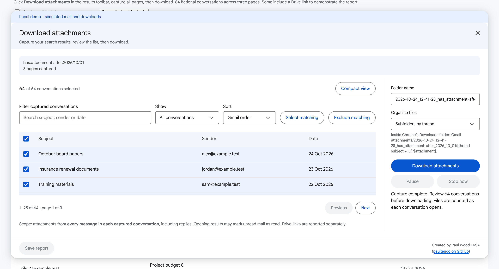

# Gmail Attachment Batch

A Tampermonkey userscript for downloading Gmail attachments in bulk. Search your inbox, choose the conversations you want, and save their attachments into organised folders.

**[Install](https://raw.githubusercontent.com/paultendo/gmail-attachment-batch/main/gmail-attachment-batch.user.js)** · [Report a bug](https://github.com/paultendo/gmail-attachment-batch/issues) · [Releases](https://github.com/paultendo/gmail-attachment-batch/releases)


## Features

- Download attachments from one page or all pages of a Gmail search.
- Review, filter and sort the conversation list before downloading. Select individual conversations or a page at a time.
- Save files in a dated batch folder, with optional subfolders for each conversation.
- Pause or stop a download batch.
- Export a CSV report of saved files and any problems.

<a id="install-in-chrome"></a>

## Installation

Requires **Chrome**, **Tampermonkey** and **Gmail in English**.

1. Install [Tampermonkey from the Chrome Web Store](https://chromewebstore.google.com/detail/tampermonkey/dhdgffkkebhmkfjojejmpbldmpobfkfo).
2. In Chrome's extension settings, open **Tampermonkey → Details** and enable **Allow User Scripts** if shown.
3. [Install Gmail Attachment Batch](https://raw.githubusercontent.com/paultendo/gmail-attachment-batch/main/gmail-attachment-batch.user.js). Tampermonkey will open an installation screen; click **Install**.
4. Enable folder downloads using the settings below, then refresh Gmail.

### Enable folder downloads

This is a one-time Tampermonkey setting:

1. Open **Tampermonkey → Dashboard → Settings**.
2. Set **Config mode** to **Advanced**.
3. Under **Downloads**, set **Download Mode** to **Browser API** and click **Save**.
4. Allow Chrome's download permission when prompted.
5. Refresh Gmail, then open **Attachment Batch → Help → Setup** and click **Check download setup**.

The check saves a small `setup-check.txt` file. Look for it inside **Gmail attachments** in your Downloads folder. You can return Tampermonkey's Config mode to Novice afterwards.

<details>
<summary>Manual installation</summary>

If the install link displays code, open **Tampermonkey → Dashboard → Create a new script**. Copy the complete [userscript](https://raw.githubusercontent.com/paultendo/gmail-attachment-batch/main/gmail-attachment-batch.user.js), replace the editor's template and save with **Ctrl+S** or **⌘S**.

You can also download the ZIP from [Releases](https://github.com/paultendo/gmail-attachment-batch/releases), unzip it and open `install.html` for a **Copy script** button.
</details>

## Usage

1. Search Gmail for the emails you want. For example:

   ```text
   from:sender@example.com has:attachment filename:pdf
   ```

2. Click **Download attachments** in the Attachment Batch toolbar.
3. Choose **All pages of this search** or **This results page only**, then click **Capture results**.
4. Click **Review list**. Untick any conversations you want to exclude. The checkbox above the list selects the current page; **Select matching** and **Exclude matching** apply to all filtered results.
5. Choose a folder name and whether to create subfolders for each conversation, then click **Download attachments**.
6. Keep the Gmail tab open while the batch runs. Click **Save report** when it finishes.

Files are saved under **Downloads → Gmail attachments → your batch folder**. The default folder name includes the date, time and search term; you can change it before downloading.

**Gmail groups emails into conversations. Attachments from replies in a selected conversation are included, even if those replies do not match your search.** Start with a small search to check the results.



<details>
<summary>Help screenshots</summary>

### Setup


### How to use


</details>

## Troubleshooting

| Problem | What to check |
| --- | --- |
| The toolbar is missing | Check the script is enabled in Tampermonkey, enable **Allow User Scripts**, refresh Gmail and run a search. |
| Downloads are blocked | Run **Help → Setup → Check download setup** and follow the instructions. |
| A file type is blocked | Add the extension under **Tampermonkey → Settings → Downloads → Whitelisted File Extensions**. The setup check uses `.txt`; reports use `.csv`. |
| Chrome asks where to save every file | Check Chrome's **Ask where to save each file** setting. |
| Capture stops | Return to the search results and capture again. Downloads remain disabled until capture completes. |
| A download is marked **unknown** | Check Chrome Downloads before retrying; the file may already have been saved. |

The **Help** button in Gmail has further instructions. See [Tampermonkey's documentation](https://www.tampermonkey.net/documentation.php?locale=en&q=GM_download) for download settings.

## Limitations

- This is an early release, tested in one English-language Gmail account on desktop Chrome. Gmail layout changes may affect it.
- It downloads attachments shown by Gmail. Drive links, links in message bodies and embedded images are not downloaded.
- Opening unread conversations may mark them as read.
- Closing or refreshing Gmail clears the batch and its download history. Save the report first. There is no resume after a reload.
- Repeating a batch in the same tab skips files already saved by that batch. It does not check for duplicates from previous batches.

## Privacy

The script runs in your signed-in Gmail tab and downloads files through Google. It does not send your email or attachments to a separate service. No Gmail API setup or additional Google sign-in is required.

CSV reports contain search terms, email subjects and filenames. Keep them private.

## Contributing

Bug reports, documentation improvements and pull requests are welcome. See [CONTRIBUTING.md](CONTRIBUTING.md) for setup and contribution guidelines, and [technical notes](docs/TECHNICAL.md) for implementation details and testing.

## Licence

[GNU GPLv3 only](LICENSE), with the author-attribution requirement in [ATTRIBUTION.md](ATTRIBUTION.md).

Created by **Paul Wood FRSA** ([paultendo on GitHub](https://github.com/paultendo)). Independent of Google and Tampermonkey.

[Buy me a coffee](https://buymeacoffee.com/paultendo)
