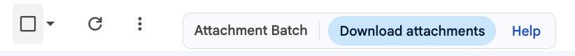
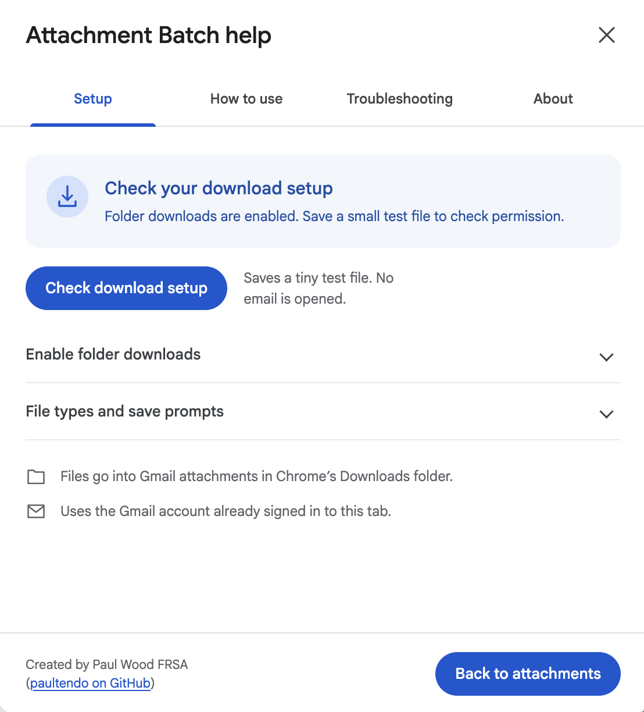
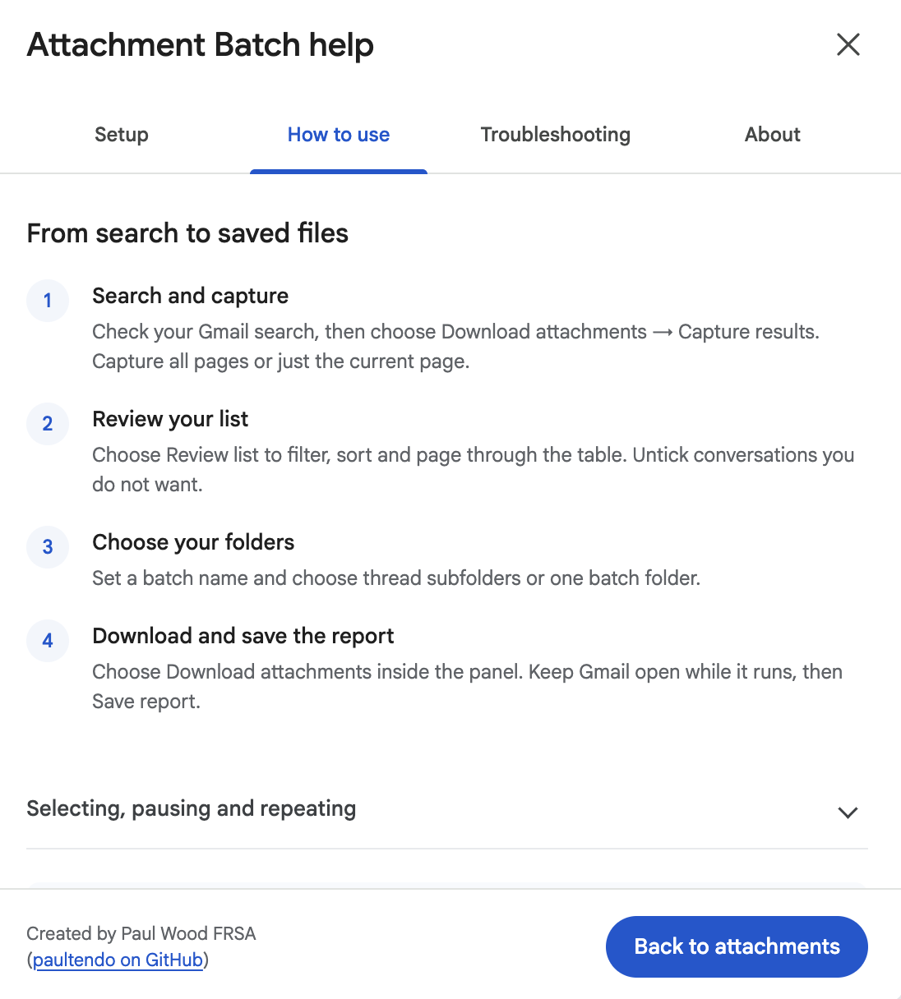

# Gmail Attachment Batch - Tampermonkey prototype

Search in Gmail, inspect the results, capture the result list, and download the attachments from those conversations. This version runs locally in the signed-in Chrome tab. It needs no Gmail API project or separate OAuth application.

Created by **Paul Wood FRSA ([paultendo on GitHub](https://github.com/paultendo))**. The author credit is visible in the batch panel and Help.



## Install in Chrome

**[Install Gmail Attachment Batch](https://raw.githubusercontent.com/paultendo/gmail-attachment-batch/main/gmail-attachment-batch.user.js)** · [Report a problem](https://github.com/paultendo/gmail-attachment-batch/issues) · [Download the package](https://github.com/paultendo/gmail-attachment-batch/releases/latest)

1. **Install [Tampermonkey for Chrome](https://chromewebstore.google.com/detail/tampermonkey/dhdgffkkebhmkfjojejmpbldmpobfkfo)** if you do not already have it. In Chrome → Extensions → Manage Extensions → Tampermonkey → Details, enable **Allow User Scripts** if shown.
2. **[Open the Attachment Batch install link](https://raw.githubusercontent.com/paultendo/gmail-attachment-batch/main/gmail-attachment-batch.user.js)** and choose **Install** in Tampermonkey. Check that the script is enabled in its dashboard.
3. **Enable folder downloads once.** Open Tampermonkey → Dashboard → Settings. Set **Config mode** to **Advanced**, find **Downloads**, set **Download Mode** to **Browser API**, then Save. Allow Chrome's download permission if requested. You can return Config mode to Novice afterwards.
4. **Refresh Gmail.** Beside Gmail's Refresh and More controls, find **Attachment Batch → Help → Setup**. Choose **Check download setup**. It saves a small `setup-check.txt` file without opening any email. Confirm it appears inside `Gmail attachments` in Chrome's Downloads folder.
5. **Try a small search** with one or two known attachments, then follow the steps below.

This prototype is for **English Gmail in desktop Chrome**. You do not need a Gmail API project, a separate Google sign-in or a paid service. The script runs in your existing Gmail tab.

<details>
<summary>If the install link opens code instead of an installation screen</summary>

Open Tampermonkey → Dashboard → Create a new script. Copy the complete [raw script](https://raw.githubusercontent.com/paultendo/gmail-attachment-batch/main/gmail-attachment-batch.user.js), replace the entire template in the editor, and save with Ctrl+S (Windows) or ⌘S (Mac). Refresh Gmail afterwards.

Alternatively, download and unzip the [latest package](https://github.com/paultendo/gmail-attachment-batch/releases/latest), then open `install.html` locally for its **Copy script** button. GitHub's file viewer displays HTML source; download the package before opening that page.

[Tampermonkey's installation instructions](https://www.tampermonkey.net/faq.php?locale=en&q=Q102).
</details>

<details>
<summary>If the Gmail buttons do not appear</summary>

Check the script is enabled in Tampermonkey and **Allow User Scripts** is enabled in Chrome's Tampermonkey details, then refresh Gmail. Use a Gmail search results page: the toolbar group appears there. [Official permission instructions](https://www.tampermonkey.net/faq.php?locale=en&q=Q209).
</details>

<details>
<summary>File types, save prompts and setup checks</summary>

Tampermonkey may require file extensions to be permitted under **Dashboard → Settings → Downloads → Whitelisted File Extensions**. Permit the attachment types you need, `.txt` for the setup check and `.csv` for reports. A successful text-file check does not verify permission for every attachment type.

Chrome's **Ask where to save each file** setting controls repeated save prompts. Chrome/Tampermonkey may change a filename, so check Chrome Downloads if a file is missing. [Download documentation](https://www.tampermonkey.net/documentation.php?locale=en&q=GM_download).

Refreshing Gmail clears the captured batch and its in-memory report. Save the report before refreshing or closing the tab. The local demo simulates downloads; it does not test your real Gmail permissions.
</details>

<details>
<summary>See the setup and how-to screens</summary>




</details>

## Download a batch

1. Search in Gmail, for example `from:sender@example.com has:attachment after:2026/01/01 before:2026/02/01`.
2. Once the results look right, click **Download attachments** in the **Attachment Batch** group beside Refresh and More, or choose **Open Attachment batch** from Tampermonkey's menu.
3. Choose **All pages of this search** or **This results page only**, then **Capture results**. The all-pages option starts at the first page and verifies Gmail's Older control and navigates to the next search-page URL. If pagination or a result ID is unrecognisable, downloading stays disabled for that incomplete capture.
4. Click **Review list** to expand a table with Subject, Sender and Date. Filter it, sort by subject or sender, and use Previous/Next to navigate 25 rows per page. **Select matching** and **Exclude matching** apply across all rows matching the current filters. Individual checkboxes also work. Use **Compact view** to shrink it again, then click **Download attachments**. Leave this Gmail tab open and let the script navigate. Opening unread messages can mark them as read.
5. **Pause** finishes the current file before waiting. **Stop now** aborts the active request and labels its outcome unknown where necessary. Inspect unknown outcomes in Chrome Downloads. Restarting the same captured batch skips its confirmed completed files and never automatically retries unknown outcomes.
6. Save the CSV report as `batch-report.csv` inside the batch folder. Files go under `Gmail attachments` in Chrome's normal Downloads location. The editable batch folder defaults to the London date, time and sanitised search term. Choose thread subfolders (subject plus stable thread ID) or one batch folder; numbered attachment filenames prevent collisions within a thread. Names are sanitised for Windows/macOS and bounded by UTF-8 byte length. Tampermonkey must use Browser API download mode to preserve subdirectories. Chrome/Tampermonkey may alter the final filename. If Chrome asks for a location for every file, its “Ask where to save each file” setting controls those prompts.

The script's queue and deduplication records live in this tab's memory. Reloading or closing it clears them; there is no persistent resume or cross-batch deduplication. Save the report before closing. Capturing a new batch clears the previous batch's in-memory record.

## Scope and limits

- **Gmail search results can be conversations.** This prototype downloads exposed attachments from every message in each captured result conversation, including replies that may not independently match the search. The panel states this before download. The list is frozen at capture; message contents/attachments are inspected when each conversation opens. Strictly message-level query matching would require a different implementation, such as the Gmail API; this project does not currently include an API version. Google describes [conversation view](https://support.google.com/mail/answer/5900?hl=en) and [UI/API search differences](https://developers.google.com/workspace/gmail/api/guides/filtering).
- It uses Gmail's DOM, not Google's supported mailbox API. Result IDs, the English Older/Expand all controls, and Chrome attachment `download_url` attributes can change. The attachment DOM convention was cross-checked against the [Gmail.js project's source](https://github.com/KartikTalwar/gmail.js/blob/master/src/gmail.js), but that is an unofficial integration. No Gmail.js dependency or remote executable dependency is loaded by this script.
- It expands Gmail's recognised Expand all control, then reads visible attachment tiles. Messages hidden behind additional “show more” controls, browser layout changes, unusual mail formats, or delayed content can still need manual checking. `no_visible_attachments` means no supported tiles were visible; it does not prove that an email contained no files.
- Drive links are reported, not downloaded. This does not traverse SharePoint links or fetch files linked in message bodies. Embedded body images are not exported as ordinary attachments. It supports the two explicitly listed Google attachment hosts and stops on cross-account download URLs.
- It counts a saved file only after `GM_download` calls `onload`. This is a Tampermonkey-reported completion, not independent verification of the downloaded bytes or final on-disk name. A missing callback times out to **unknown**, aborts, and is not automatically replayed. The requested filename and known status remain in the report.
- The report contains the search, subjects, message/attachment context, requested filenames and outcomes, without signed attachment URLs. Spreadsheet formula prefixes are escaped. No email body, file bytes, login credentials or report is sent to an external service by the script. Network downloads use the user's existing Google access.

## Verification performed

22 automated tests cover Trusted Types-safe mounting, toolbar replacement/navigation, Gmail query encoding and permanent routes, folder naming and duplicate-subject/file handling, table filtering/paging/selection, search extraction, unknown layouts, pagination, hidden panes, decimal thread IDs, cross-account/host checks, distinct attachments sharing a filename, cloud links, path-safe filenames, CSV escaping, completion callbacks, failures, stop/timeout outcomes and skipping completed files on a repeated run. A local demo exercises the review panel and navigation using fictional mail and simulated downloads.

**Live Chrome test:** the toolbar button opened the review panel, one known result was captured, and its PDF was downloaded. The test PDF matched an existing original by SHA-256. Running the same captured batch again created no second PDF. Gmail’s Trusted Types policy and permanent conversation URLs are supported. The interface follows Gmail’s typography, compact spacing and blue controls.

**Live pagination:** one search captured 567 conversations across 12 Gmail pages successfully. Capture updates its count and review table as pages arrive.

**Live multi-download:** two known PDFs from two conversations were saved under one batch folder with separate subject/ID thread folders. Both were checked as PDFs, their CSV paths matched the saved files, and repeating the batch created no extra PDFs.

**Testing other Gmail accounts is still needed.** Start with a small search whose expected attachments are known, compare actual saved files against the report, then try a multi-page search. This prototype is not represented as a verified complete mailbox export.

```sh
npm install --ignore-scripts
npm test
```

`demo.html` is a local interactive example. It never connects to a real mailbox. `tests/batch.test.cjs` uses synthetic DOM fixtures; these are not evidence of compatibility with a particular live Gmail layout.

## Development and publication

`npm ci --ignore-scripts` installs development-only test dependencies. The installed userscript has no third-party runtime dependency. `npm test` runs the synthetic tests; `npm run build` refreshes the copy-and-paste installer, verification hash and distributable ZIP. Building requires Node.js and Python 3. See [PUBLISHING.md](PUBLISHING.md) for the release checklist.

Licensed under **[GNU GPLv3 only](LICENSE)**, with a reasonable author-attribution term under section 7(b), set out in [ATTRIBUTION.md](ATTRIBUTION.md). Keep “Paul Wood FRSA (paultendo on GitHub)” and the profile link in the source and Help/About legal notices. Contributions and commercial use are welcome. Distributed modified covered versions must remain under the GPL and come with corresponding source for recipients; private changes do not need to be published. No warranty is provided. This add-on is independent of Google and Tampermonkey.

## Contributing

Bug reports, usability improvements, documentation and focused fixes are welcome. [CONTRIBUTING.md](CONTRIBUTING.md) has the short setup and contribution guide; [CONTRIBUTORS.md](CONTRIBUTORS.md) explains how contributions are credited.

## Help and support

Choose **Attachment Batch → Help** in Gmail for Setup, How to use, Troubleshooting and About. For bugs and feature suggestions, use [GitHub Issues](https://github.com/paultendo/gmail-attachment-batch/issues). Include your Chrome, Tampermonkey and add-on versions, the error message and the steps that led to it. Use fictional examples or redacted screenshots; do not upload private emails, attachments, signed URLs or reports.

[Paul Wood FRSA on GitHub](https://github.com/paultendo) · [Buy me a coffee](https://buymeacoffee.com/paultendo)
